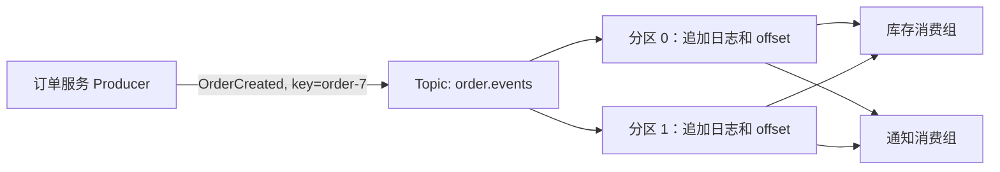

# 消息队列与 MQ 核心知识

## 为什么需要消息队列

先看一个没有消息队列的场景：

**订单服务直接调用三个下游**

```
用户下单
  → 订单服务写数据库（10ms）
    → 调用库存服务扣库存（50ms）
      → 调用通知服务发短信（200ms）
        → 调用报表服务更新统计（100ms）
```

总耗时：10 + 50 + 200 + 100 = 360ms。用户等了 360ms 才看到"下单成功"。如果通知服务的短信网关抖动到 3 秒，用户就等 3 秒多——但发短信真的需要让用户等吗？

引入消息队列后：

```
用户下单
  → 订单服务写数据库（10ms）
    → 发送 OrderCreated 事件到 Kafka（5ms）
      → 返回"下单成功"给用户（总计 15ms）

同时，三个下游各自从 Kafka 读取事件：
  → 库存服务消费 → 扣库存
  → 通知服务消费 → 发短信
  → 报表服务消费 → 更新统计
```

用户只等 15ms，三个下游各自独立处理，互不影响。这就是消息队列的核心价值。

## 核心术语

| 术语 | 含义 | 快递站类比 |
| --- | --- | --- |
| **消息（message）** | 一次业务事实或命令，通常含 key、value、时间戳和 headers | 一个包裹 |
| **Topic** | 消息的逻辑名称；Kafka Topic 由多个分区组成 | 一个货架分类 |
| **分区（partition）** | 有序追加日志，顺序只在单个分区内有保证 | 货架上的一列 |
| **offset** | 分区内消息的位置编号，不是全局唯一序号 | 包裹在列中的位置号 |
| **消费组（consumer group）** | 组内实例分工读分区；不同组各读一份 | 不同快递员各自取件 |
| **Producer** | 发送消息到 Topic 的客户端 | 寄件人 |
| **Consumer** | 从 Topic 读取消息的客户端 | 取件人 |
| **Broker** | Kafka 服务端节点，存储消息并提供读写 | 快递站本身 |

## 什么时候用消息队列

消息队列解决三类问题：

### 1. 异步处理：缩短用户等待

如上面的订单案例，把不需要同步等待的操作改为异步消费。判断标准是：**这个操作的结果用户需要立即看到吗？** 发短信、更新统计、记录日志——用户不需要等。扣库存——如果是"先扣再下单"，用户需要知道是否有库存。

### 2. 解耦：生产方不需要知道所有下游

订单服务只需要发出 `OrderCreated` 事件，不需要知道有几个下游在消费。新增一个"风控审计"服务只需要创建新的消费组订阅同一 Topic，订单服务一行代码都不用改。

如果没有消息队列，订单服务要直接调用每个下游。新增一个下游就要改订单服务代码、加调用逻辑、处理超时和重试——这叫硬编码耦合。

### 3. 削峰：缓冲流量尖峰

秒杀场景下每秒 10 万订单，数据库扛不住直接写入。让 Producer 先把消息发到 Kafka（Kafka 每秒可处理百万级消息），消费者按照数据库能承受的速率（比如每秒 1 万）平滑消费。消息在 Kafka 中短暂积压，但数据库不会被打垮。

**但消息队列也带来新问题**：消息会晚到、可能重复、可能积压。不能把同步事务的成功直接等同于消息链路成功。

## 消息不能替代同步调用

什么时候不该用消息队列？

- **需要立即获得结果**：查询商品价格、计算订单金额——用户等着看结果，不能用异步。
- **结果必须确定**：支付扣款——必须等扣款成功才能告诉用户"已支付"，不能发完消息就说"支付成功"。
- **操作极简单且量小**：直接 HTTP 调用比维护一个 Kafka 集群简单得多。

## Kafka 的多消费组模型

Kafka 和传统消息队列有一个重要区别：**同一条消息可以被多个消费组各自读取**。



同一个消费组分摊分区，不同消费组各自保留独立的消费进度。如果只有两个分区，同一组开五个实例也不会让五个实例同时处理五个分区——多出的实例会空闲。

传统队列（如 RabbitMQ）的消息被一个消费者取走后就删除了，其他消费者看不到。Kafka 的消息不会因消费而删除，而是按保留期（默认 7 天）持久存储。这就是为什么 Kafka 适合"事件流"场景：多个下游各自独立读取同一份数据。

## 交付语义

消息的投递保证有三种语义，理解它们对正确设计业务至关重要：

### 最多一次（at-most-once）

消息可能丢失，但不会重复。Producer 发出去不等确认（`acks=0`），或者消费者处理前先提交 offset。

- **适用**：日志上报、监控指标——丢几条没关系。
- **风险**：业务消息可能丢失。

### 至少一次（at-least-once）

消息不会丢失，但可能重复。Producer 等确认并重试（`acks=all`），消费者处理完再提交 offset。

- **适用**：大多数业务场景——订单、支付、库存。
- **风险**：重复消息需要业务侧做幂等处理。
- **Kafka 默认实践**：Producer 开启 `acks=all` + `enable.idempotence=true`，Consumer 关闭自动提交、处理完手动提交。

### 恰好一次（exactly-once）

消息不丢不重。需要 Kafka 事务 + 消费者读取-处理-写入都在同一事务内。

- **适用**：Kafka 内部的流处理（Kafka Streams）。
- **限制**：Kafka 事务只覆盖 Kafka 内部读写，不能自动保证外部数据库的恰好一次。如果消费者先写 MySQL 再提交 offset，两步不在同一事务中，崩溃时可能出现不一致。

### 实务中的选择

绝大多数业务使用"至少一次 + 业务幂等"：

- 消费者用 `orderId` 做唯一约束或幂等记录表。
- 收到重复消息时，检查 `orderId` 是否已处理过——已处理则跳过。
- 这样即使消息重投，业务效果也只产生一次。

### 幂等处理的具体例子

假设消费者收到 `OrderCreated(orderId=O-7)` 后要扣库存：

1. 第一次收到：检查 `O-7` 未处理 → 扣库存 → 记录 `O-7 已处理` → 提交 offset
2. 第二次收到（重复投递）：检查 `O-7` 已处理 → 跳过 → 提交 offset

"记录已处理"可以是一张 `processed_events` 表，用 `eventId` 做主键。写入和业务操作放在同一数据库事务中，保证要么一起成功要么一起失败。

## 崩溃时会发生什么

理解下面的崩溃场景，才能真正明白消息可靠性：

### 场景一：先更新数据库，再提交 offset

```
1. 消费者收到消息 → 处理 → 更新 MySQL 成功
2. 提交 offset 前，消费者崩溃
3. 重启后从上次提交的 offset 继续 → 再次处理同一条消息
```

结果：数据库被更新了两次。如果没有幂等，库存扣了两次。这就是为什么必须做幂等。

### 场景二：先提交 offset，再更新数据库

```
1. 消费者收到消息 → 提交 offset
2. 更新 MySQL 前，消费者崩溃
3. 重启后从新 offset 继续 → 跳过这条消息
```

结果：消息被标记为已消费但业务没执行。这就是为什么"先提交再处理"会丢业务效果——不能用这种方式换取"不重复"。

### 正确做法

先处理业务（在数据库事务中同时写幂等记录），再提交 offset。崩溃时最坏情况是重复处理，但幂等保证了业务安全。

## Kafka 和传统 MQ 的关注点

| 关注点 | Kafka | 传统 MQ（RabbitMQ / ActiveMQ） |
| --- | --- | --- |
| 消息生命周期 | 按保留期持久存储，消费后不删除 | 消费后删除 |
| 多组独立读 | 不同消费组各自保留 offset，独立读取 | 一条消息只投递一次 |
| 消息重放 | 可以按 offset 重新读取历史消息 | 不支持，消息已删除 |
| 顺序保证 | 分区内有序 | 队列内有序 |
| 吞吐量 | 极高（顺序磁盘写 + 零拷贝） | 中等 |
| 路由模型 | Topic + 分区 + key 路由 | Exchange + Queue + Binding |
| 适用场景 | 事件流、日志、监控、CDC | 任务队列、RPC 路由、延迟队列 |

JMS 是 Java 消息 API 规范，AMQP 是消息协议；Kafka 提供自己的分区日志与客户端协议。两者都能异步解耦，选择时看是否需要重放、多组独立读取、顺序范围、吞吐与运维能力，而不是只比较"能不能发消息"。[Kafka 设计文档](https://kafka.apache.org/documentation/#design)。
