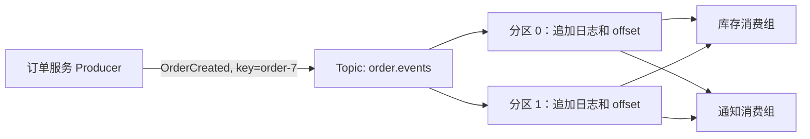

# 消息队列与 MQ 核心知识

## 核心术语

- **消息（message）**：一次业务事实或命令，通常含 key、value、时间戳和 headers。
- **Topic**：消息的逻辑名称；Kafka Topic 由多个分区组成。
- **分区（partition）**：有序追加日志。顺序只在单个分区内有保证。
- **offset**：分区内消息的位置，不是全局唯一序号。
- **消费组（consumer group）**：组内实例分工读分区；不同组各读一份。

## 什么时候用

异步处理能缩短请求等待，解耦让生产方不必直接调用所有下游；队列还能缓冲流量尖峰。但消息会晚到、重复、积压，不能把同步事务的成功直接等同于消息链路成功。

例如“订单创建”接口原本同步调用库存、通知、报表三个服务，只要其中一个慢，接口就慢。改成订单服务写入 `OrderCreated` 事件后，三个下游各用自己的消费组读取，就可以独立扩缩容和失败重试。但订单接口返回时，只能说订单写入及发送步骤按设计完成；不能说通知已经送达。

同一个消费组分摊分区，不同消费组各自保留进度。若只有两个分区，同一组开五个实例也不会让五个实例同时处理五个分区；多出的实例会空闲。

## Kafka 和传统 MQ 的关注点

JMS 是 Java 消息 API 规范，AMQP 是消息协议；Kafka 提供自己的分区日志与客户端协议。传统队列常强调消息出队及路由，Kafka 强调记录保留、按 offset 重读和独立消费组。两者都能异步解耦，选择时看是否需要重放、多组独立读取、顺序范围、吞吐与运维能力，而不是只比较“能不能发消息”。

## 交付语义

“最多一次”可能丢，“至少一次”可能重，“恰好一次”需要限定 Kafka 事务与读写边界，不能自动覆盖外部数据库。实务中常用至少一次消费，并用业务 ID 做幂等。Kafka 与 JMS/AMQP 的接口和路由模型不同，不应把术语机械对应。[Kafka 设计文档](https://kafka.apache.org/documentation/#design)可继续查证。

假设消费服务先更新 MySQL，再提交 offset：数据库成功、提交前进程崩溃，重启就可能再次更新。以 `orderId` 做唯一约束或幂等记录，才能让重复消息不产生第二次业务效果。反过来先提交 offset 再更新数据库，崩溃会导致这条消息被跳过，业务结果缺失。
