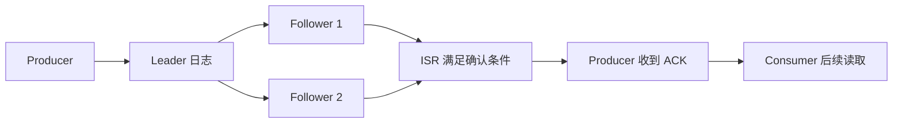

# 存储、复制与可靠性

## 分区日志与 segment

每个分区是一个**有序的、不可变的追加日志**。消息只能追加到末尾，不能修改已有消息。物理上，每个分区日志按 **segment**（段文件）切分存储。

可以把分区想成一个编号连续的账本：

- **Producer** 在账本末尾写新条目（追加）
- **Consumer** 自己保存"读到了第几条"的书签（offset）
- **segment** 是账本的分卷，便于索引和清理

当前活跃的 segment 叫 active segment，Producer 写入的目标就是它。当 active segment 达到配置大小（默认 1GB）或时间阈值时，滚动成新 segment。旧的 segment 变为只读。

### 消息不会因消费而删除

这是 Kafka 和传统消息队列的关键区别。传统队列中消费者取走消息后，消息就从队列中消失；Kafka 的消息不管被多少消费者读取过，都留在分区日志中，直到被清理。

清理策略有两种：

| 策略 | 行为 | 适用场景 |
| --- | --- | --- |
| **按时间删除（delete）** | 超过 `retention.ms`（默认 7 天）的 segment 被整体删除 | 事件流、日志 |
| **紧凑化（compact）** | 对每个 key 只保留最新的 value，旧 value 被清理 | 状态快照、配置变更 |

两种不能混为一谈。紧凑化不是删除旧 segment，而是对同一 key 的多条消息只留最新一条。比如 Topic 中有 `user-1` 的多条消息（改名、改名、改名），紧凑化后只剩最后一条改名结果。

## Leader、Follower 与 ISR

单节点 Broker 没有冗余——磁盘损坏消息全丢。生产环境需要**副本（replica）**保证数据安全。

每个分区有一个 Leader 和零到多个 Follower：

- **Leader**：接收该分区所有读写请求。Producer 写消息到 Leader，Consumer 从 Leader 读消息。
- **Follower**：从 Leader 拉取数据复制到自己。Follower 不直接服务客户端读写。
- **ISR（In-Sync Replicas）**：当前满足同步条件的副本集合，包括 Leader 和跟得上进度的 Follower。

### 副本怎么工作

```
Producer 写消息 → Leader 追加到日志
                  ↓
              Follower 1 拉取复制 ✓（在 ISR 中）
              Follower 2 拉取复制 ✓（在 ISR 中）
              Follower 3 落后太多 ✗（不在 ISR 中）
```

Follower 通过持续拉取 Leader 的最新消息来保持同步。如果某个 Follower 落后太多（超过 `replica.lag.time.max.ms`，默认 30 秒），它会被移出 ISR。ISR 是动态变化的——Follower 赶上来会重新加入 ISR。

### `acks=all` 真的可靠吗

`acks=all` 的含义是"等待当前 ISR 中所有副本确认后才向 Producer 返回成功"。但要注意：

- 单节点实验只有一个副本，ISR 只有 Leader 自己，`acks=all` 等于 `acks=1`，不能验证多副本容错。
- 如果 `min.insync.replicas=1`，即使有 3 个副本，只要 1 个在 ISR 中就可以确认写入——这意味着可能只写入了一个副本。

**举例**：副本数 3、`min.insync.replicas=2`、Producer `acks=all`：

1. **三副本健康**：ISR = {Leader, F1, F2}，写入需等至少 2 个确认 → 成功
2. **F2 离开 ISR**：ISR = {Leader, F1}，仍有 2 个同步副本 ≥ `min.insync.replicas=2` → 继续可写
3. **只剩 Leader 同步**：ISR = {Leader}，1 < `min.insync.replicas=2` → 拒绝写入，Producer 收到异常

第 3 种情况看起来是"不可用"，但它是保护数据一致性的正确行为：宁可拒绝写入，也不能让消息只存在一个副本上。如果此时把 `min.insync.replicas` 设成 1 来"恢复可用性"，就回到了只有一个副本保证的状态——后续 Leader 磁盘损坏，这条消息就永久丢失了。

**结论**：不能单看 `acks=all` 就宣称多副本安全。副本数、`min.insync.replicas` 和 ISR 状态三个配置一起看，才知道实际保障。[Producer ACK 配置](https://kafka.apache.org/41/configuration/producer-configs/)。



## HW、LEO 与可见性

这两个概念描述了分区日志中消息的"可见性边界"。

### LEO（Log End Offset）

日志末端位置——下一条要写入的 offset。如果分区当前有 offset 0~4 的五条消息，LEO 是 5。

### HW（High Watermark）

已满足复制可见性条件的 offset——Consumer 能读到的最大 offset。HW ≤ LEO。

**为什么需要 HW？** 如果 Leader 写了一条消息但 Follower 还没复制，此时 Leader 故障，消息会丢失。为了防止 Consumer 读到这种"未完全复制的消息"，Kafka 规定 Consumer 只能读到 HW 以下的消息。

### 三个不同的"成功"

| 事件 | 含义 | 谁关心 |
| --- | --- | --- |
| Producer 收到 ACK | Broker 已持久化消息（满足 acks 策略） | Producer |
| Consumer 能读到（HW 以上） | 消息已复制到足够副本，对 Consumer 可见 | Consumer |
| 业务处理成功 | 消费者处理完消息并产生业务效果 | 业务方 |

这三个事件不是同一件事。Producer 收到 ACK 只说明消息到了 Broker；Consumer 读到只说明能取数据；业务处理成功才是最终目标。

### 副本故障时检查什么

当 Broker 故障时，分区可能需要切换 Leader。检查顺序：

1. **ISR 是否有足够副本**：ISR 中是否有满足 `min.insync.replicas` 的副本可做新 Leader。
2. **是否允许非 ISR 副本选主**：`unclean.leader.election.enable` 如果为 `true`，允许落后副本当 Leader（可能丢数据）；如果为 `false`，ISR 不足时分区不可用（等待原 Leader 恢复）。

生产环境通常设为 `false`——宁可暂时不可用也不要丢数据。但这意味着 ISR 不足时分区会停止写入，需要监控告警及时处理。

## 消息丢失的风险点

整条链路上消息可能丢失的环节：

| 环节 | 丢失原因 | 防范 |
| --- | --- | --- |
| Producer → Broker | 网络断开，Producer 未重试 | `acks=all` + `retries` 足够大 + `enable.idempotence=true` |
| Broker 单副本 | 磁盘损坏 | 副本数 ≥ 3 + `min.insync.replicas ≥ 2` |
| Broker 消息保留过期 | 消费者长时间不消费 | 合理设置 `retention.ms` 或增加消费能力 |
| Consumer 先提交后处理 | 崩溃后消息被跳过 | 先处理再提交 + 业务幂等 |
| 非干净 Leader 选举 | 选了落后副本当 Leader | `unclean.leader.election.enable=false` |

## 最小检查

用下面的命令查看实验 Topic 的分区和副本状态：

```powershell
docker exec kafka-lab /opt/kafka/bin/kafka-topics.sh --bootstrap-server localhost:9092 --describe --topic learning.events
```

观察每个分区的 `Leader`、`Replicas`、`Isr` 三个字段。单节点实验中三者都是同一个 Broker 编号。

如果有多节点集群，可以模拟故障：停掉 Leader 所在 Broker，观察 Topic describe 输出中 Leader 是否切换、ISR 是否缩减。**实验时先记下副本数与 ISR，再模拟故障；不要在生产集群随意停节点**。[Kafka 设计与复制](https://kafka.apache.org/documentation/#replication)。

## 可靠性配置速查

| 配置项 | 位置 | 推荐值 | 说明 |
| --- | --- | --- | --- |
| `acks` | Producer | `all` | 等待 ISR 所有副本确认 |
| `enable.idempotence` | Producer | `true` | 生产者重试不产生重复 |
| `retries` | Producer | `Integer.MAX_VALUE` | 持续重试直到成功或超时 |
| `max.in.flight.requests.per.connection` | Producer | ≤ 5 | 幂等模式下的限制 |
| `replication.factor` | Topic | ≥ 3 | 每个分区至少 3 个副本 |
| `min.insync.replicas` | Topic/Broker | ≥ 2 | 至少 2 个同步副本才允许写入 |
| `unclean.leader.election.enable` | Broker | `false` | 不允许落后副本当 Leader |
| `enable.auto.commit` | Consumer | `false` | 手动提交，处理完再提交 |
| `retention.ms` | Topic | 按需设置 | 消息保留时间，默认 7 天 |
