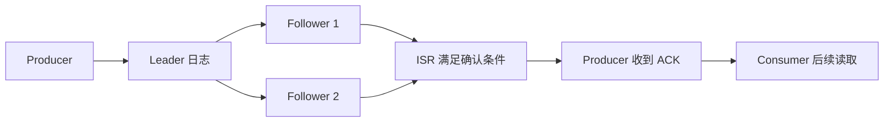

# 存储、复制与可靠性

## 分区日志与 segment

每个分区是追加日志，物理上按 segment 切分；offset 是逻辑位置。消息保留时间和大小由 Topic 配置决定，消费并不会立即删除记录。日志清理可能按时间删除，紧凑化则保留每个 key 的较新值，两者不能混为一谈。

可以把分区想成编号连续的账本：Producer 在末尾写，Consumer 自己保存读到哪里。日志不会因为某个 Consumer 读完就被它“取走”；另一个消费组仍可从自己的位置读取。segment 是账本分卷，便于索引、过期清理和文件管理，不意味着消息跨卷后顺序消失。

## Leader、Follower 与 ISR

分区 Leader 接收读写，Follower 跟随复制。ISR 是当前满足同步条件的副本集合；`acks=all` 的实际保障依赖 ISR、`min.insync.replicas`、副本数和不可用副本时的写入策略。单节点实验不能验证副本容错。

举例：副本数 3、`min.insync.replicas=2`、Producer `acks=all`。三副本健康时可确认；一副本离开 ISR 后仍有 2 个可继续写；只剩 1 个同步副本时应拒绝新的可靠写入。若把最小 ISR 设成 1，“all” 可能只等一个副本，故不能单看 `acks=all` 就宣称多副本安全。[Producer ACK 配置](https://kafka.apache.org/41/configuration/producer-configs/)。



## HW、LEO 与可见性

LEO（Log End Offset）指日志末端下一位置，HW（High Watermark）是已满足复制可见性条件的边界。Producer 收到确认、Consumer 能读到、业务处理成功是三个不同事件。副本故障时要检查 ISR 缩减、Leader 切换和是否允许非 ISR 副本选主。

不要把 HW 理解成“所有消费者都处理完了”；它属于 Broker 复制和可见性的边界。消费组的已提交 offset 在另一层，描述应用下一次从哪里读。两组消费者即使面对同一个 HW，也可能有不同的处理进度。

## 最小检查

```powershell
docker exec kafka-lab /opt/kafka/bin/kafka-topics.sh --bootstrap-server localhost:9092 --describe --topic learning.events
```

观察每个分区的 Leader、Replicas、Isr。实验时先记下副本数与 ISR，再模拟故障；不要在生产集群随意停节点。[Kafka 设计与复制](https://kafka.apache.org/documentation/#replication)。
